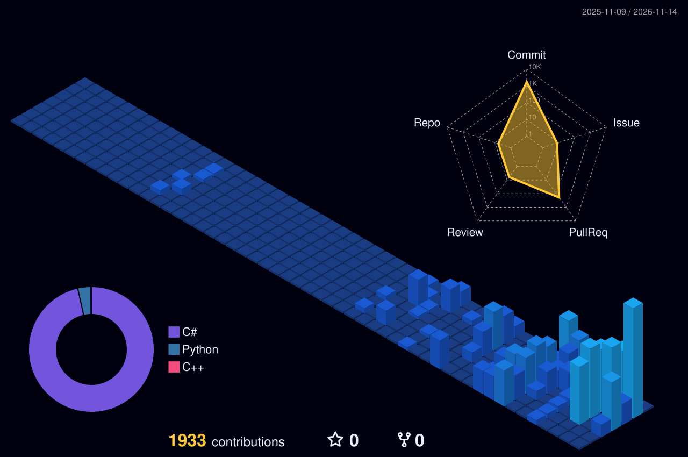
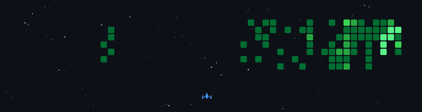

<!--
  Profile README for github.com/AdzAhm

  Images:
    assets/header.svg, assets/footer.svg  made by scripts/generate_space_svgs.py
                                          (edit the text/colors there and re-run it)
    profile/*                             rebuilt daily by .github/workflows/profile.yml
-->

  

   

  

## 🛰️ About me

- 💻 Computer engineer who likes building things from the ground up: logic gates, renderers, physics simulations.
- 🔭 I'm currently working on **[BitSorter](https://github.com/AdzAhm/BitSorter)**
- 🌱 Exploring graphics programming, multithreading in modern C++, and GPU computing.
- 💬 Ask me about Unity, C and C++, Arduino, or digital logic.
<!-- - ⚡ Fun fact: add yours here and remove the comment markers -->

## 🧰 Tech stack

<table align="center">
  <tr>
    <td align="right"><b>Languages</b></td>
    <td></td>
  </tr>
  <tr>
    <td align="right"><b>Engines &amp; hardware</b></td>
    <td></td>
  </tr>
  <tr>
    <td align="right"><b>Tools</b></td>
    <td></td>
  </tr>
  <tr>
    <td align="right"><b>Creative</b></td>
    <td></td>
  </tr>
  <tr>
    <td align="right"><b>Workspace</b></td>
    <td></td>
  </tr>
</table>

## 🚀 Featured projects

<!--
  These cards are rebuilt every day from the repos themselves (description,
  main language, stars, forks), so changes to a project show up here on their own.
  To feature a different repo, change the repo name in a line below, in both the
  link and the image path (profile/pin-<repo name>.svg). Up to 6 cards.
  Pushing that edit to main rebuilds the cards within a few minutes.
  A card shows the repo's description, set from the gear icon next to "About"
  on the repo's GitHub page.
-->

  
  
  

## 📊 GitHub stats

  
  
    
  
    
  

## 🏅 Trophies & code activity

  
    
  

## 👾 Contribution invaders

  

<!-- To show this section: fill in your handles, then delete this line and the closing marker line at the end of the section.
## 🤝 Let's connect

  
  
  
  
  

-->

